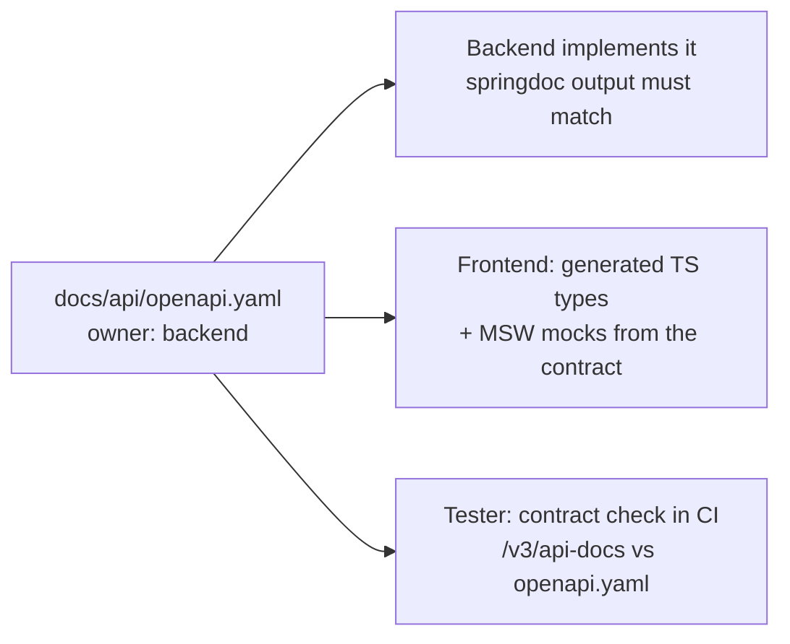
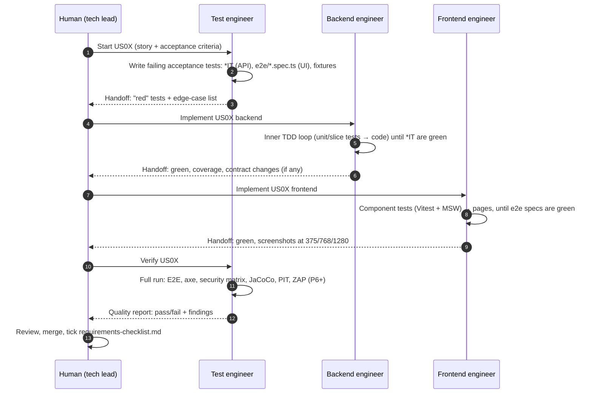

# Agent Team Guide

This project is built by three AI agents, each with one area of responsibility. A human (the tech lead) reviews and merges every change.

| Agent | Definition | Folder rules | Owns |
|---|---|---|---|
| **Backend engineer** | [.claude/agents/backend-engineer.md](../../.claude/agents/backend-engineer.md) | [backend/AGENTS.md](../../backend/AGENTS.md) | Spring Boot code + unit and slice tests |
| **Frontend engineer** | [.claude/agents/frontend-engineer.md](../../.claude/agents/frontend-engineer.md) | [frontend/AGENTS.md](../../frontend/AGENTS.md) | Next.js / HeroUI / Redux code + component tests |
| **Test engineer** | [.claude/agents/test-engineer.md](../../.claude/agents/test-engineer.md) | — (rules in its definition) | Acceptance, integration, E2E, security and accessibility tests; quality reports |

All three also follow the shared rules in the root [AGENTS.md](../../AGENTS.md).

---

## 1. Who owns which files

An agent edits **only** the files it owns. It may read anything. If it needs a change in a file someone else owns, it writes a request in its handoff note (§4). **It never edits that file itself.**

| Path | Backend | Frontend | Tester |
|---|---|---|---|
| `backend/*/src/main/**` | ✏️ owner | — | 👀 read only |
| `backend/*/src/test/**/*Test.java` (unit, slice, ArchUnit) | ✏️ owner | — | 👀 reviews |
| `backend/*/src/test/**/*IT.java` (integration, E2E, security matrix) | 👀 must make them pass, **never edits them** | — | ✏️ owner |
| `backend/infrastructure/src/test/resources/pokeapi/**` (recorded fixtures) | 👀 | — | ✏️ owner |
| `backend/**/pom.xml`, `backend/**/db/migration/**` | ✏️ owner | — | 👀 |
| `docs/api/openapi.yaml` (API contract) | ✏️ owner | 👀 builds against it | 👀 checks it in tests |
| `frontend/src/**` (incl. `*.test.tsx` next to components) | — | ✏️ owner | 👀 reviews |
| `frontend/src/mocks/**` (MSW handlers) | — | ✏️ owner | 👀 |
| `frontend/e2e/**` (Playwright, axe, console guard) | — | 👀 must make them pass, **never edits them** | ✏️ owner |
| `frontend/package.json`, `next.config.ts`, `proxy.ts` | — | ✏️ owner | 👀 |
| `.github/workflows/**`, `docker-compose.yml`, Dockerfiles | proposes | proposes | ✏️ owner (quality gates) |
| `docs/**` (except the agent's own handoff notes) | proposes | proposes | proposes |
| Root `AGENTS.md`, ADRs | **Human only.** Agents propose changes in handoff notes | | |

**Why the tester owns the acceptance tests:** the developer agent must make the tests pass but may not edit them. This stops the classic AI shortcut of changing the test to fit the code, and gives our TDD rule ("never write a test and the code it tests in the same step") a structural guarantee.

## 2. How the agents share an API

The **API contract** is `docs/api/openapi.yaml`. It is written **before** implementation, from [architecture.md §2.8](../architecture.md), so the frontend and backend can work at the same time.



- The frontend generates TypeScript types from the contract (`openapi-typescript`) and mocks the API with MSW, so it doesn't wait for the backend.
- A change to the contract is **breaking until proven otherwise**. The backend agent describes it in its handoff note, and the human approves before the frontend picks it up.

## 3. Workflow per user story



Steps 4–7 (backend) and 7–10 (frontend) can run **at the same time** once the contract for the story exists, because the frontend works against MSW mocks.

**Working in parallel without conflicts:** each agent works on its own branch (`agent/backend/us03-sync`, `agent/frontend/us03-sync`, `agent/test/us03-sync`), ideally in its own git worktree. The file ownership in §1 means two agents never edit the same file.

## 4. Handoff note (every agent, every task)

Each agent ends its task with this note, in its final message and in the PR description:

```markdown
## Handoff — <agent> — <story/task>

**Status:** ✅ done · 🟡 partial · 🔴 blocked
**Branch:** agent/<role>/<slug>

### What changed
- <files / classes / components, one line each>

### Verification (commands run + result)
- `<command>` → <pass/fail, numbers>

### Contract / cross-agent requests
- <change requested in a file I don't own, and why> (or "none")

### Open questions / risks
- <anything the human must decide> (or "none")

### GenAI notes (for docs/genai/prompt-log.md)
- <AI suggestion rejected or corrected, and why> (or "none")
```

## 5. Definition of done per agent

| Agent | Done when |
|---|---|
| **Backend** | Story `*IT` tests green · per-module JaCoCo gates pass · enforcer + ArchUnit green · Spotless clean · springdoc output matches `openapi.yaml` · no outdated APIs (root AGENTS.md list) · handoff note written |
| **Frontend** | Story Playwright specs green at 375/768/1280 · Vitest coverage ≥ 80% · `tsc --noEmit` + ESLint clean · zero console warnings/errors (incl. hydration and CSP) · HeroUI components used where they exist · handoff note with screenshots |
| **Tester** | Acceptance tests trace back to the story and to [testing-strategy §5](../testing-strategy.md) edge cases · each test fails for the right reason before implementation · quality report published · no flaky tests (3 runs in a row green) |

## 6. When an agent must stop and ask the human

- A test it doesn't own is failing and it believes **the test** is wrong
- It needs a new dependency, a contract change, a schema migration that changes existing data, or a new ADR
- A requirement is ambiguous, or two docs contradict each other
- A security rule ([security.md](../security.md)) would have to be weakened to make something work
- Any build gate (coverage, enforcer, ArchUnit, ZAP, axe) would have to be lowered

## 7. How to run the agents (Claude Code)

The definitions in `.claude/agents/` are Claude Code subagents. Ask for one by name, e.g. *"Use the test-engineer agent to write the US03 acceptance tests"*, or let Claude pick it from the agent's `description`. Folder rules (`backend/AGENTS.md`, `frontend/AGENTS.md`) load automatically when an agent works inside that folder. Other tools (Cursor, Copilot) can read the same `AGENTS.md` files.
