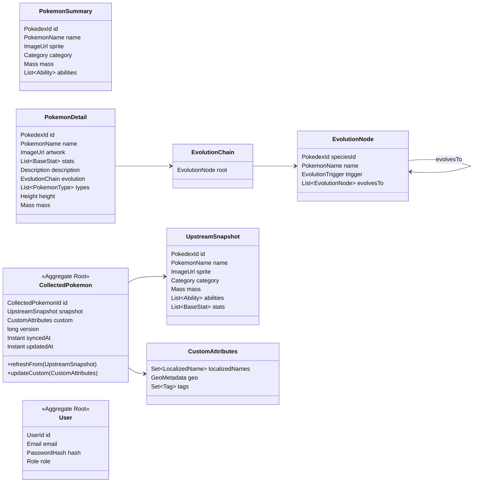
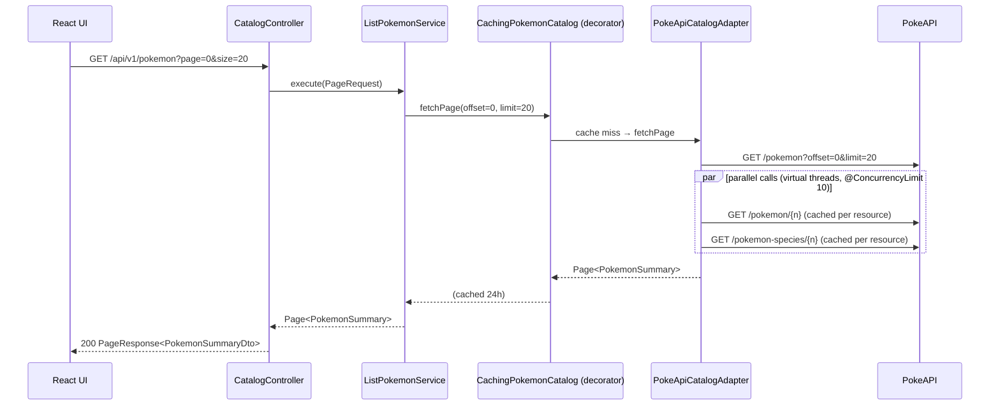
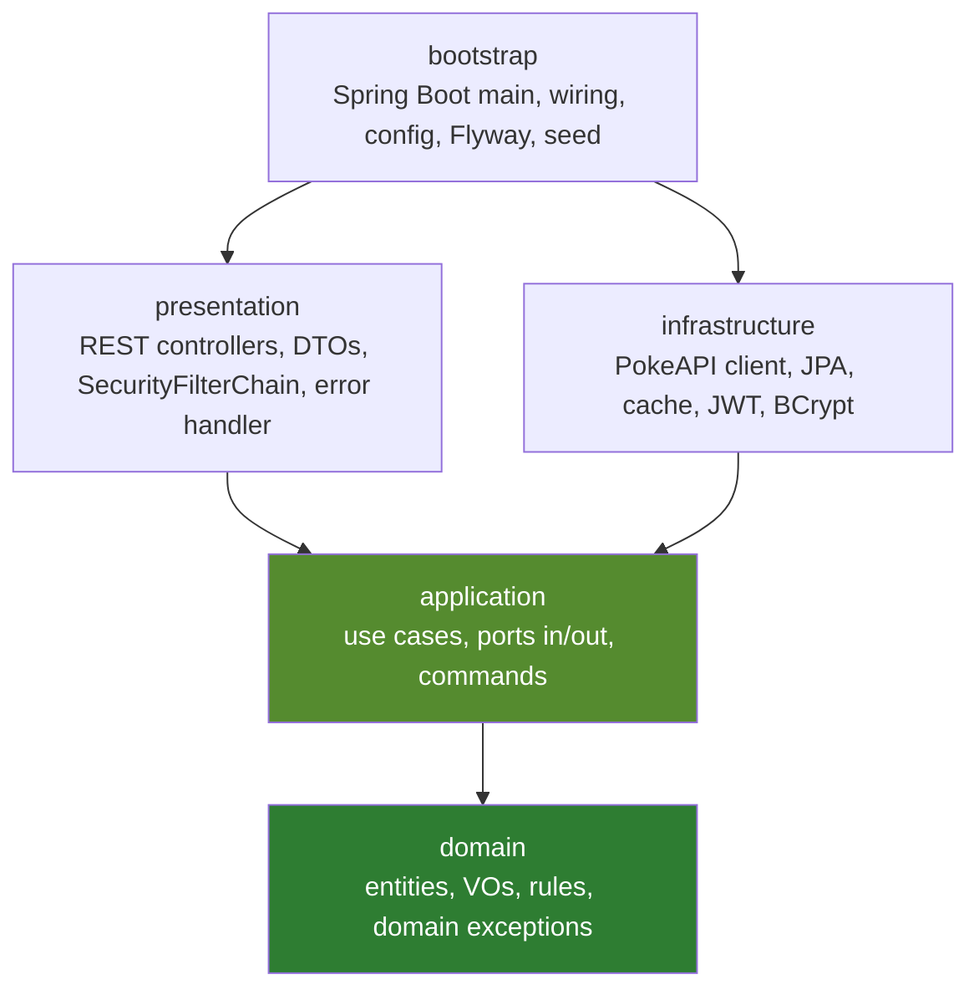
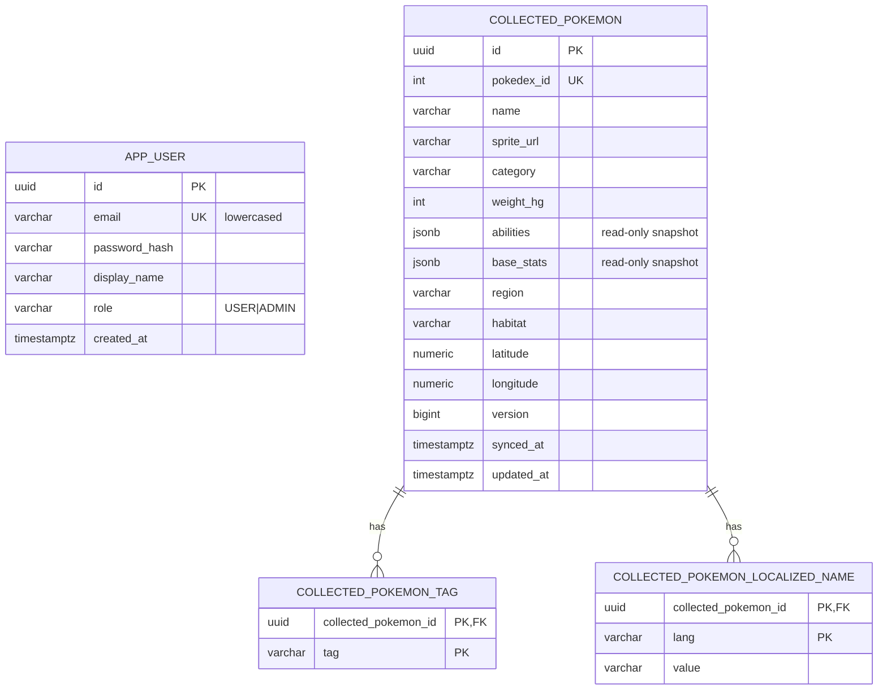
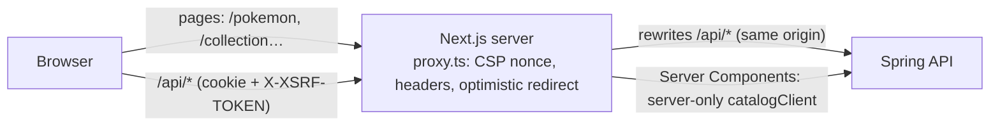

# Architecture Blueprint

> Related: [security.md](security.md) · [ui-ux.md](ui-ux.md) · [testing-strategy.md](testing-strategy.md) · [roadmap.md](roadmap.md) · [genai/workflow.md](genai/workflow.md) · [adr/](adr/)

## 0. Assumptions and key decisions

### 0.1 How the exercise's terms map to PokeAPI

The exercise leaves a few terms open. These are the readings we use:

| Term in the exercise | Reading | PokeAPI source |
|---|---|---|
| "sprite" | `sprites.front_default`, with a fallback image | `/pokemon/{id}` |
| "category" | Species genus, e.g. *"Mouse Pokémon"* | `/pokemon-species/{id}` → `genera[lang=en]` |
| "mass" | `weight`, which PokeAPI gives in **hectograms**; shown in kg | `/pokemon/{id}` |
| "skills" | Abilities, with a hidden flag (moves are left out: there are hundreds per Pokémon) | `/pokemon/{id}` → `abilities` |
| "image" (detail) | `sprites.other.official-artwork.front_default` | `/pokemon/{id}` |
| "core statistics" | The six base stats | `/pokemon/{id}` → `stats` |
| "narrative description" | English flavor text, cleaned up | `/pokemon-species/{id}` → `flavor_text_entries` |
| "evolutionary lineage" | The full evolution tree, branches included | `/evolution-chain/{id}` |

### 0.2 Decisions (ADRs)

| ADR | Decision |
|---|---|
| [0001](adr/0001-maven-multi-module-clean-architecture.md) | Maven multi-module build that enforces Clean Architecture layers |
| [0002](adr/0002-catalog-vs-collection-split.md) | Read-only **Catalog** (PokeAPI) kept separate from the local **Collection** (CRUD) |
| [0003](adr/0003-postgresql-flyway-testcontainers.md) | PostgreSQL + Flyway, Testcontainers in tests |
| [0004](adr/0004-caffeine-cache-decorator.md) | Caffeine cache in a decorator around the PokeAPI adapter |
| [0005](adr/0005-jwt-oauth2-resource-server.md) | Stateless JWT using Spring OAuth2 Resource Server |
| [0006](adr/0006-react-redux-toolkit.md) | React + TypeScript + Redux Toolkit (RTK Query) |
| [0007](adr/0007-java-25-spring-boot-4.md) | Java 25 + Spring Boot 4.1.1 |
| [0008](adr/0008-httponly-cookie-token-and-csrf.md) | JWT in an httpOnly cookie + CSRF protection; same origin, no CORS |
| [0009](adr/0009-heroui-v3-component-library.md) | HeroUI v3 (React Aria) as the UI component library |
| [0010](adr/0010-nextjs-app-router.md) | Next.js 16 App Router: Server Components for the catalog, RTK Query for the collection |

---

## 1. Domain model

### 1.1 Bounded contexts

```
┌───────────────────────┐   ┌────────────────────────────┐   ┌──────────────────────┐
│  CATALOG (read-only)  │   │  COLLECTION (local store)  │   │  IDENTITY            │
│  Source: PokeAPI      │──▶│  Source: PostgreSQL        │   │  Source: PostgreSQL  │
│  US01, US02           │   │  US03, US04 + full CRUD    │   │  register/login/me   │
└───────────────────────┘   └────────────────────────────┘   └──────────────────────┘
          ▲ public                    ▲ authenticated                  ▲ public + auth
```

### 1.2 Entities, aggregates and value objects

All domain types are plain Java records or classes with no framework annotations. Each one checks its own rules in its constructor.



| Value object | Rule it enforces |
|---|---|
| `PokedexId` | int > 0 |
| `PokemonName` | lowercase, `^[a-z0-9-]{1,50}$` (`mr-mime`, `ho-oh`, `porygon-z`) |
| `Mass` | Built from hectograms; `kilograms()` rounded to 0.1; never negative |
| `Height` | Built from decimetres; `meters()` |
| `BaseStat` | name ∈ {hp, attack, defense, special-attack, special-defense, speed}; value 1–255 |
| `Ability` | name plus a `hidden` flag |
| `Description` | `\f`, `\n` and soft hyphens become spaces; whitespace collapsed; may be empty |
| `Category` | non-blank, or `Category.UNKNOWN` |
| `Tag` | lowercased, `^[a-z0-9-]{1,30}$` |
| `LocalizedName` | BCP-47 language tag + a 1–60 char value; at most one per language |
| `GeoMetadata` | region ≤ 60, habitat ≤ 60, optional `Coordinates` (lat −90..90, lon −180..180) |
| `Email` | trimmed, lowercased, valid format |
| `PageRequest` | page ≥ 0, 1 ≤ size ≤ 100, default size 20 |

### 1.3 Business rules

| ID | Rule |
|---|---|
| BR-01 | Pagination: page ≥ 0, size 1–100. A page past the end returns empty content, not an error. |
| BR-02 | Mass is stored upstream in hectograms and always shown in kg (69 hg → 6.9 kg). |
| BR-03 | The description is the English flavor text from the latest game version that has one, cleaned up. If there is none, it is empty, not an error. |
| BR-04 | The evolution chain keeps branches (Eevee has 8) and stage order. |
| BR-05 | **Sync is an idempotent upsert keyed by `PokedexId`.** A re-sync refreshes `UpstreamSnapshot` and never touches `CustomAttributes`. |
| BR-06 | **Only `CustomAttributes` can change through US04.** Upstream fields belong to PokeAPI; trying to change them returns 400. |
| BR-07 | Tags are normalized: trimmed, lowercased, de-duplicated, at most 10. |
| BR-08 | Optimistic concurrency: an update with an old `version` returns 409. |
| BR-09 | Email must be unique (stored lowercased). Password is 12–64 characters with no composition rules, and is rejected if it's on the common-password list (OWASP ASVS / NIST 800-63B). The domain only ever holds the hash. |
| BR-10 | Access: Catalog is public. Collection reads, sync and update need `USER`. Delete needs `ADMIN`. Anything not listed is denied. Full matrix in [security.md §3](security.md). |

### 1.4 Use cases

| UC | Story | Input → Output | Main failures |
|---|---|---|---|
| UC-01 `ListPokemon` | US01 | `PageRequest` → `Page<PokemonSummary>` | invalid page → 400; upstream down → 503 |
| UC-02 `GetPokemonDetail` | US02 | id or name → `PokemonDetail` | not found → 404 |
| UC-03 `SyncPokemon` | US03 | `PokedexId` → `CollectedPokemon` (created or refreshed) | not upstream → 404; upstream down → 503 |
| UC-04 `UpdateCollectedPokemon` | US04 | `UpdateCustomAttributesCommand` → `CollectedPokemon` | missing → 404; invalid → 400; stale → 409 |
| UC-05 `List/Get/DeleteCollectedPokemon` | CRUD | filters (tag, name) / id | 404, 403 |
| UC-06 `RegisterUser` | Auth | email, password, displayName → `User` | duplicate → 409; weak → 400 |
| UC-07 `AuthenticateUser` | Auth | credentials → `AccessToken` | bad credentials → 401 (generic message) |
| UC-08 `GetCurrentUser` | Auth | principal → `User` | 401 |

### 1.5 Listing Pokémon: many PokeAPI calls per page (main performance risk)

PokeAPI's list endpoint returns only `{name, url}`. So one page of 20 needs **1 list call, 20 `/pokemon` calls and 20 `/pokemon-species` calls**.



**If some calls fail:** each failed item is retried (`@Retryable`, only on 5xx or IO errors). If an item still fails, the whole page returns **503 ProblemDetail**. We do not return half-filled cards.

---

## 2. Clean Architecture boundaries

### 2.1 Dependency direction



- `domain`: JDK only (plus JSpecify annotations). No Spring, JPA, Jackson or Lombok.
- `application`: `domain` + JDK only. Use cases are plain classes; `bootstrap` turns them into beans with `@Bean`.
- `presentation` ↮ `infrastructure`: neither may depend on the other.
- **Transactions:** `bootstrap` wraps the write use cases in a `TransactionalUseCaseDecorator` built on `TransactionTemplate`, so `@Transactional` stays out of `application`.
- **Two guards:** `maven-enforcer-plugin` bans framework dependencies in `domain`/`application` when the build runs, and ArchUnit checks package rules at test time.

### 2.2 Ports

| Kind | Port (in `application`) | Adapter |
|---|---|---|
| Inbound | `ListPokemonUseCase`, `GetPokemonDetailUseCase`, `SyncPokemonUseCase`, `UpdateCollectedPokemonUseCase`, `QueryCollectionUseCase`, `DeleteCollectedPokemonUseCase`, `RegisterUserUseCase`, `AuthenticateUserUseCase`, `GetCurrentUserUseCase` | REST controllers (`presentation`) |
| Outbound | `PokemonCatalogPort` (`fetchPage`, `fetchDetail`, `fetchSnapshot`) | `PokeApiCatalogAdapter`, wrapped by `CachingPokemonCatalog` |
| Outbound | `CollectedPokemonRepository` | `JpaCollectedPokemonRepositoryAdapter` |
| Outbound | `UserRepository` | `JpaUserRepositoryAdapter` |
| Outbound | `PasswordHasher` | `BCryptPasswordHasher` |
| Outbound | `TokenIssuer` | `JwtTokenIssuer` (Spring `JwtEncoder`) |
| Outbound | `java.time.Clock` (injected) | `Clock.systemUTC()`; fixed clock in tests |

**Where each data shape may go:**
- PokeAPI DTOs stay in `infrastructure.pokeapi.dto` and ignore unknown fields.
- JPA entities stay in `infrastructure.persistence.entity`.
- REST DTOs stay in `presentation`. They reject unknown fields and are mapped to `Command`s before reaching a use case.
- Mappers are written by hand and unit-tested.

### 2.3 Repository layout

```
pokedex/
├── README.md, AGENTS.md, CLAUDE.md
├── .claude/agents/                  # backend-engineer, frontend-engineer, test-engineer (see docs/agents/)
├── docker-compose.yml               # postgres, backend, frontend (Next.js standalone); profile "offline" adds wiremock
├── .github/workflows/ci.yml
├── docs/                            # this folder; docs/api/openapi.yaml = API contract
├── backend/
│   ├── pom.xml                      # parent: spring-boot-starter-parent 4.1.1, java.version=25
│   ├── mvnw, mvnw.cmd, .mvn/wrapper/
│   ├── Dockerfile                   # maven:3.9-eclipse-temurin-25 → eclipse-temurin:25-jre, non-root
│   ├── domain/
│   │   ├── pom.xml                  # no Spring deps; test: junit-jupiter, assertj, jqwik
│   │   └── src/main/java/com/pokedex/domain/
│   │       ├── catalog/             # PokemonSummary, PokemonDetail, EvolutionChain, EvolutionNode
│   │       │   └── vo/              # PokedexId, PokemonName, Mass, Height, BaseStat, Ability, Description…
│   │       ├── collection/          # CollectedPokemon, UpstreamSnapshot, CustomAttributes
│   │       │   └── vo/              # Tag, LocalizedName, GeoMetadata, Coordinates
│   │       ├── identity/            # User, Email, PasswordHash, Role
│   │       └── shared/              # Page, PageRequest, sealed DomainException hierarchy
│   ├── application/
│   │   ├── pom.xml                  # → domain; builds a test-jar with the in-memory fakes
│   │   └── src/main/java/com/pokedex/application/
│   │       ├── catalog/{port/in, port/out, service}/
│   │       ├── collection/{port/in, port/out, service, command}/
│   │       ├── identity/{port/in, port/out, service, command}/
│   │       └── shared/exception/
│   ├── infrastructure/
│   │   ├── pom.xml                  # → application; restclient, data-jpa, flyway, caffeine, oauth2-jose, postgresql
│   │   └── src/main/java/com/pokedex/infrastructure/
│   │       ├── pokeapi/             # PokeApiHttpClient (@HttpExchange), dto/, PokeApiMapper, PokeApiCatalogAdapter
│   │       ├── cache/               # CachingPokemonCatalog, CacheConfig
│   │       ├── persistence/         # entity/, springdata/, adapter/, mapper/
│   │       └── security/            # BCryptPasswordHasher, JwtTokenIssuer
│   ├── presentation/
│   │   ├── pom.xml                  # → application; webmvc, validation, security, oauth2-resource-server, springdoc
│   │   └── src/main/java/com/pokedex/presentation/
│   │       ├── rest/catalog/        # CatalogController, dto/
│   │       ├── rest/collection/     # CollectionController, dto/
│   │       ├── rest/identity/       # AuthController, dto/
│   │       ├── rest/error/          # GlobalExceptionHandler → RFC 9457 ProblemDetail
│   │       └── security/            # SecurityFilterChain, CORS, route rules
│   └── bootstrap/
│       ├── pom.xml                  # → all; spring-boot-maven-plugin; JaCoCo report-aggregate
│       └── src/
│           ├── main/java/com/pokedex/       # PokedexApplication, config/UseCaseConfig, config/TxConfig, seed/DemoDataSeeder
│           ├── main/resources/
│           │   ├── application.yml, application-demo.yml, application-offline.yml
│           │   ├── db/migration/            # V1__users.sql, V2__collected_pokemon.sql
│           │   └── seed/pokemon-snapshot.json
│           └── test/java/…                  # *IT E2E flows, ArchUnit rules
└── frontend/                         # Next.js 16 (App Router) + HeroUI v3 + Redux Toolkit
    ├── Dockerfile                   # next build (output: 'standalone') → node:24-alpine, non-root
    ├── next.config.ts               # rewrites /api/* → Spring API, images.remotePatterns, headers(), poweredByHeader: false
    ├── src/
    │   ├── proxy.ts                 # per-request CSP nonce + security headers; optimistic /collection redirect
    │   ├── app/
    │   │   ├── layout.tsx           # <html suppressHydrationWarning>, Providers (Theme, Store, Toast), AppShell
    │   │   ├── globals.css          # @import "tailwindcss"; @import "@heroui/styles"; theme layer
    │   │   ├── not-found.tsx, error.tsx, global-error.tsx
    │   │   ├── page.tsx             # redirects to /pokemon
    │   │   ├── (public)/pokemon/
    │   │   │   ├── page.tsx         # Server Component: catalog grid (US01), await searchParams
    │   │   │   ├── loading.tsx      # skeleton grid
    │   │   │   └── [idOrName]/      # page.tsx (US02, Server Component), loading.tsx, not-found.tsx
    │   │   ├── (auth)/login/page.tsx, (auth)/register/page.tsx          # Client Component forms
    │   │   └── (protected)/collection/
    │   │       ├── page.tsx         # Client Component: collection table (RTK Query)
    │   │       └── [pokedexId]/page.tsx   # view + edit (US04)
    │   ├── server/                  # 'server-only': catalogClient.ts (fetch BACKEND_INTERNAL_URL), mappers
    │   ├── store/                   # makeStore.ts, StoreProvider.tsx ('use client', useRef), hooks.ts, listeners.ts
    │   ├── shared/
    │   │   ├── api/                 # baseApi.ts (createApi), baseQuery.ts (credentials, X-XSRF-TOKEN, ProblemDetail, 401/403 handling)
    │   │   ├── ui/                  # AppLink (HeroUI render + next/link), AppShell, EmptyState, ErrorState, ErrorSummary
    │   │   └── lib/                 # formatName, isSafeHttpUrl, safeRedirect, problem-type → copy map
    │   ├── features/
    │   │   ├── catalog/             # PokemonCard, PokemonGrid, CatalogPagination, StatMeters, EvolutionTree, AddToCollectionButton ('use client')
    │   │   ├── collection/          # collectionApi.ts, CollectionTable, CollectionCards, EditCustomAttributesForm
    │   │   └── auth/                # authSlice.ts, authApi.ts, LoginForm, RegisterForm, UserMenu
    │   └── styles/themes/pokedex.css   # HeroUI variable overrides + Pokémon type colors (@theme inline)
    ├── e2e/                         # Playwright specs (also covers async Server Components)
    └── vitest.config.ts
```

### 2.4 Maven build

| Plugin | Purpose |
|---|---|
| `maven-enforcer-plugin` | `requireJavaVersion [25,)`, `requireMavenVersion [3.9,)`, `dependencyConvergence`; **bans `org.springframework*`, `jakarta.persistence*`, `tools.jackson*`, `com.fasterxml.jackson*` and Lombok in `domain` and `application`** |
| `maven-surefire-plugin` | Unit tests (`*Test.java`) |
| `maven-failsafe-plugin` | Integration and E2E tests (`*IT.java`) |
| `jacoco-maven-plugin` | A coverage gate (`check`) in each module; `report-aggregate` in `bootstrap` |
| `pitest-maven` + `pitest-junit5-plugin` | Mutation testing in a `-Pmutation` profile (`domain`, `application`) |
| `spotless-maven-plugin` | Formatting (palantir-java-format) |
| `maven-jar-plugin` (`test-jar`) | Shares `application`'s fakes (`<type>test-jar</type><scope>test</scope>`) |

### 2.5 Spring Boot 4 / Framework 7 specifics

| Area | Choice |
|---|---|
| Starters | Boot 4's per-module starters: `spring-boot-starter-webmvc`, the per-technology test starters, and the Flyway Boot starter + `flyway-database-postgresql`. Confirm exact names on start.spring.io. |
| Jackson 3 | `tools.jackson.*`. Annotations stay in `com.fasterxml.jackson.annotation`. |
| PokeAPI client | `@HttpExchange` interface backed by `RestClient`, registered with `@ImportHttpServices`. Connect timeout 2 s, read timeout 5 s. |
| Resilience | Framework 7 `@Retryable` (5xx/IO, exponential backoff, max 3) + `@ConcurrencyLimit(10)`, turned on with `@EnableResilientMethods`. No Resilience4j. |
| Virtual threads | `spring.threads.virtual.enabled=true`; the list fan-out uses `Executors.newVirtualThreadPerTaskExecutor()` |
| Tests | `@MockitoBean`; `@ServiceConnection` on Testcontainers containers |
| OpenAPI | springdoc-openapi 3.x at `/swagger-ui` |

### 2.6 Java 25 features used

| Feature | Use |
|---|---|
| Records + compact constructors | All value objects and commands |
| Sealed interfaces | `DomainException`, `EvolutionTrigger`, `ApiError`, which gives an exhaustive `switch` in `GlobalExceptionHandler` |
| Pattern matching for `switch` / record patterns | Mapping errors to HTTP status; PokeAPI DTO → domain |
| Virtual threads | PokeAPI fan-out |
| **No preview features** | Keeps JaCoCo, PIT, ArchUnit and Mockito compatible |

### 2.7 Persistence schema



The upstream snapshot is stored as JSONB because it is read-only and never queried field by field. Tags and localized names are our own data and we filter by them, so they get their own tables.

### 2.8 API contract

| Method | Path | Auth | Success | Errors |
|---|---|---|---|---|
| GET | `/api/v1/pokemon?page&size` | public | 200 `PageResponse<PokemonSummaryDto>` | 400, 503 |
| GET | `/api/v1/pokemon/{idOrName}` | public | 200 `PokemonDetailDto` | 400, 404, 503 |
| POST | `/api/v1/auth/register` | public | 201 `UserDto` | 400, 409, 429 |
| GET | `/api/v1/auth/csrf` | public | 200 `{headerName, token}` | — |
| POST | `/api/v1/auth/login` | public | 200 `{user, expiresAt}` + `Set-Cookie: access_token` (httpOnly) | 400, 401, 403 (CSRF), 429 |
| POST | `/api/v1/auth/logout` | USER | 204, cookie cleared | 401 |
| GET | `/api/v1/auth/me` | USER | 200 `UserDto` | 401 |
| POST | `/api/v1/collection` `{pokedexId}` | USER | 201 + `Location` (new) / 200 (refreshed) | 400, 401, 404, 503 |
| GET | `/api/v1/collection?page&size&tag&q` | USER | 200 `PageResponse<CollectedPokemonDto>` | 400, 401 |
| GET | `/api/v1/collection/{pokedexId}` | USER | 200 | 401, 404 |
| PUT | `/api/v1/collection/{pokedexId}` (full `customAttributes` + `version`) | USER | 200 | 400, 401, 404, 409, 413, 415 |
| DELETE | `/api/v1/collection/{pokedexId}` | ADMIN | 204 | 401, 403, 404 |

- `PageResponse = {content, page, size, totalElements, totalPages}`.
- Every error is an RFC 9457 `ProblemDetail` with an `errors[]` list of field violations.
- US04 uses PUT, not PATCH: replacing the whole object avoids having to decide whether `null` means "clear" or "unchanged".
- Authentication uses the `access_token` httpOnly cookie. Every non-GET request needs the `X-XSRF-TOKEN` header (403 if missing). Controls in [security.md](security.md).

---

## 3. Frontend architecture (Next.js 16 + HeroUI v3 + Redux Toolkit)

### 3.1 Request path



- The browser only ever talks to the Next.js server (same origin: no CORS; cookies are first-party).
- Server Components call the Spring API **server to server** for public catalog data only. They never receive or forward the user's token.

### 3.2 Rendering split

| Page | Component type | Data source | Why |
|---|---|---|---|
| `/pokemon` (US01) | **Server Component** | `catalogClient.getPage(await searchParams)` | Public and read-only. HTML arrives already rendered: fast LCP, no spinner |
| `/pokemon/[idOrName]` (US02) | **Server Component** + `AddToCollectionButton` (Client) | `catalogClient.getDetail(await params)`; `notFound()` on a 404 | Same; only the button needs interactivity |
| `/login`, `/register` | Client Component | RTK Query `authApi` mutations | Forms, CSRF, error handling |
| `/collection`, `/collection/[pokedexId]` (US03/US04) | Client Component | RTK Query `collectionApi` | Authenticated, changing data, cache refresh after edits, 409 handling |

**Rule:** public read-only data → Server Component. Authenticated or changing data → RTK Query in a Client Component.

### 3.3 Where state lives

| State | Where | Why |
|---|---|---|
| Catalog list and detail | Server Component props (rendered on the server) | No client cache needed; the backend's Caffeine cache keeps it fast |
| Collection list and item | RTK Query `collectionApi`, tags `Collection` / `{type:'Collection', id}` | Sync, update and delete mark these as stale, so they refetch |
| Auth (current user, `expiresAt`; **never the token**) | `authSlice` (`createSlice`) | App-wide state |
| Page number and filters | URL `searchParams` | Back/forward and shareable links work |
| Form input | React Hook Form + Zod | Short-lived; stays out of the store |
| Toasts | HeroUI `toast()` + `<Toast.Provider />` | Kept out of Redux to avoid duplicating state |
| Theme | `next-themes` (stored in `localStorage`) | Single theme controller (ADR 0009) |

**Rule:** never copy RTK Query data into a slice.

### 3.4 Redux Toolkit in the App Router

- `makeStore()` is called **per request** inside `StoreProvider` (`'use client'`, `useRef`), following RTK's Next.js guide. **No module-level store**: on the server it would be shared between users.
- Each feature adds its endpoints to one shared `baseApi` with `injectEndpoints`.
- `baseQuery` uses `credentials: 'same-origin'` (the browser sends the httpOnly cookie) and copies the `XSRF-TOKEN` cookie into the `X-XSRF-TOKEN` header on non-GET requests. It turns `ProblemDetail` responses into a typed `ApiError` and dispatches `logout()` on 401. On a 403 `csrf-token-invalid` it fetches a new token and retries once.
- Spring Security only creates the CSRF token when it is needed, so the app calls `GET /auth/csrf` **on startup, after login and after logout** ([security.md §4.2.1](security.md)).
- **The token never reaches JavaScript** ([ADR 0008](adr/0008-httponly-cookie-token-and-csrf.md)). On startup the app calls `GET /auth/me` to restore the session.
- **Sync:** marks the `Collection` list as stale. **Update:** waits for the server, then writes the response into the cache with `updateQueryData` (not before the server confirms, since a 409 would mean rolling back). **Delete:** marks the item and the list as stale.
- The store holds only serializable values (ISO date strings), so RTK's development checks print no console warnings.

### 3.5 Routing and protection

- File-based routes with the route groups `(public)`, `(auth)`, `(protected)`. `loading.tsx` shows skeletons, `error.tsx` shows the error state with retry, `not-found.tsx` shows the 404 page.
- `proxy.ts` redirects `/collection/**` to `/login?from=…` when the `access_token` cookie is **absent**. This is a UX shortcut only. The Spring API enforces every rule ([security.md §3.3](security.md)).
- Internal links use `AppLink`, which passes `next/link` through HeroUI's `render` prop. `params` / `searchParams` are awaited (they are Promises in Next.js 16).

### 3.6 UI

Components, design tokens, layouts, flows and accessibility rules are in [ui-ux.md](ui-ux.md).
