# Implementation Roadmap

> Related: [architecture.md](architecture.md) · [testing-strategy.md](testing-strategy.md) · [requirements-checklist.md](requirements-checklist.md)

**Current phase:** P0 — Inception & Scaffolding (documentation done; build setup not started)

```mermaid
gantt
    dateFormat X
    axisFormat %s
    section Backend
    P0 Scaffolding & CI        :p0, 0, 1
    P1 Domain (TDD)            :p1, after p0, 1
    P2 Use cases (TDD)         :p2, after p1, 1
    P3 Infrastructure adapters :p3, after p2, 2
    P4 API & Security          :p4, after p3, 1
    section Frontend & Delivery
    P5 Frontend                :p5, after p4, 2
    P6 Packaging & Seed        :p6, after p5, 1
    P7 Polish, Docs, GenAI     :p7, after p6, 1
```

*(Bar lengths show relative effort, not calendar days.)*

## Phases

### P0 — Inception & Scaffolding
- **Scope:** Public Git repo; Maven build (parent POM + 5 modules) with the wrapper; enforcer, Surefire/Failsafe, JaCoCo, PIT, Spotless; OWASP Dependency-Check + CycloneDX; Dependabot; `.env.example`; ArchUnit skeleton; Next.js 16 + TS strict + ESLint + HeroUI v3 + Redux Toolkit store skeleton (`makeStore`, `StoreProvider`); confirm whether `@heroui/react` ships `"use client"` directives; GitHub Actions (`setup-java` 25, Maven cache, Node); Compose with PostgreSQL; ADRs; `AGENTS.md` (root + `backend/` + `frontend/`); agent definitions in `.claude/agents/`; **first version of the API contract `docs/api/openapi.yaml`** (from architecture §2.8) so the frontend and test agents can start in parallel.
- **Entry:** Blueprint approved. JDK 25 (Temurin) and Docker available.
- **Exit:**
  - [ ] `./mvnw verify` and `npm run build` pass in CI
  - [ ] Adding `spring-context` to `domain` on a test branch **fails the build** (proves the enforcer works)
  - [ ] Adding a deliberate cross-layer import **fails ArchUnit**
  - [ ] A sample test runs under JaCoCo, PIT, ArchUnit and Mockito on Java 25 bytecode
  - [ ] Dependency-Check and `npm audit` run in CI

### P1 — Domain (TDD)
- **Scope:** All value objects, `CollectedPokemon`, `User`, `EvolutionChain`, the sealed domain exceptions; business rules BR-01…BR-09 as tests.
- **Entry:** P0 done.
- **Exit:** ≥ 95% line coverage, PIT ≥ 80%, enforcer and ArchUnit both green.

### P2 — Application use cases (TDD)
- **Scope:** UC-01…UC-08, port interfaces, commands, in-memory fakes in the test-jar.
- **Entry:** Domain API stable.
- **Exit:** Every use case tested, failure paths included; ≥ 95% coverage; no infrastructure types referenced.

### P3 — Infrastructure adapters
- **Scope:** PokeAPI `@HttpExchange` client + DTOs + mapper + parallel calls (virtual threads, `@ConcurrencyLimit`) + `@Retryable`; Caffeine decorator; Flyway V1–V2; JPA entities and adapters; BCrypt and JWT adapters.
- **Entry:** Port interfaces frozen.
- **Exit:** WireMock suite covers every upstream case in the testing strategy; Testcontainers suite green; cache-hit and concurrent-sync tests pass; no N+1 queries (checked with Hibernate statistics).

### P4 — API & Security
- **Scope:** Controllers, REST DTOs + Bean Validation, `GlobalExceptionHandler` → ProblemDetail, `SecurityFilterChain`, CORS, springdoc.
- **Entry:** Use cases wired in `bootstrap`.
- **Exit:** `@WebMvcTest` tests and the RestAssured E2E flow pass: register → login → sync → update → get → delete. Per-module JaCoCo gates enforced in CI. **Authorization-matrix test, CSRF, security-header, rate-limit and no-secrets-in-logs tests pass** ([security.md §6](security.md)).

### P5 — Frontend
- **Scope:** Next.js 16 App Router + HeroUI v3 + Tailwind v4. `proxy.ts` (CSP nonce, headers, optimistic redirect); `/api` rewrites; Server Component catalog grid + pagination and detail page (stat meters, evolution tree); auth pages; collection table; sync button; edit form. RTK Query endpoints, `authSlice`, per-request `StoreProvider`; `next-themes`; HeroUI theme file.
- **Entry:** OpenAPI contract stable.
- **Exit:** All 4 user stories usable in the UI, matching the flows and wireframes in [ui-ux.md](ui-ux.md); Vitest ≥ 80%; Playwright acceptance scenarios ([ui-ux §11](ui-ux.md)) pass at 3 viewports; **zero console warnings** (enforced by a test), including CSP violations; 0 serious/critical axe violations; Lighthouse accessibility ≥ 90.

### P6 — Packaging & Seed
- **Scope:** Multi-stage Dockerfiles (non-root user, health checks, layered jar); Compose profiles `default` and `offline` (WireMock with the recorded PokeAPI fixtures); a `demo` profile that seeds an `ADMIN` and a `USER` account plus a Gen-1 collection with custom fields.
- **Entry:** P4 and P5 done.
- **Exit:** `docker compose up` from a fresh clone gives a working demo, and it also works **with no internet** using `--profile offline`. The Next.js standalone image (Node 26 Alpine, non-root) sends the nonce-based CSP and security headers. **The OWASP ZAP baseline scan reports no High findings.**

### P7 — Polish, Docs & GenAI
- **Scope:** Final README (setup, env vars, demo credentials, test commands, coverage); finished ADRs; GenAI task-management write-up; prompt log; demo script for the presentation.
- **Entry:** Everything green.
- **Exit:** Full rehearsal done; every item in [requirements-checklist.md](requirements-checklist.md) ticked.

## Risk register

| Risk | Impact | Mitigation |
|---|---|---|
| PokeAPI is slow or rate-limits us during the live demo | Demo breaks | `offline` Compose profile + seeded data + caching |
| One list page needs ~41 PokeAPI calls | Slow pages | Parallel calls with a concurrency limit, per-resource caching, a test that checks cache hits |
| A test tool doesn't support Java 25 bytecode yet | CI fails | Use the versions Spring Boot manages; pin compatible versions of PIT, ArchUnit and Spotless; checked in P0 |
| AI generates Boot 2/3-era code | Subtle bugs | Outdated-API list in `AGENTS.md`; review checklist in [genai/workflow.md](genai/workflow.md) |
| Over-engineering eats into the time budget | Late delivery | Anything beyond the minimum needs a one-line justification in an ADR |
