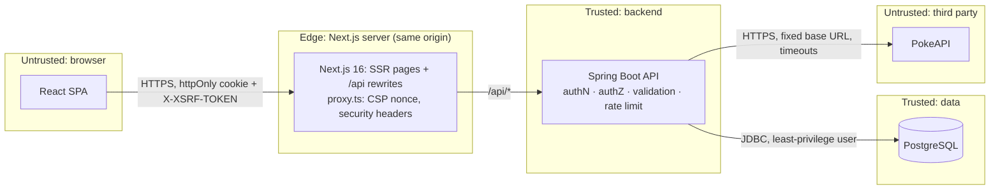

# Security Design (OWASP-aligned)

> Related: [architecture.md](architecture.md) · [ADR 0005](adr/0005-jwt-oauth2-resource-server.md) · [ADR 0008](adr/0008-httponly-cookie-token-and-csrf.md) · [testing-strategy.md](testing-strategy.md)

## 1. Standards and target level

| Standard | How it is used |
|---|---|
| **OWASP Top 10:2025** | Risk checklist for the whole web app (§7) |
| **OWASP API Security Top 10:2023** | Risk checklist for the REST API (§8) |
| **OWASP ASVS 5.0** | Verification target: **all of Level 1, plus the Level 2 controls listed in §9** |
| OWASP Cheat Sheet Series | Implementation guidance: Authentication, Password Storage, JWT for Java, CSRF, REST Security, Logging, XSS, Content Security Policy |

**Why L1 + selected L2:** Level 1 is the minimum for any public app. Level 2 is the norm for apps that hold user accounts. We apply the Level 2 controls that matter for this app (password storage, sessions, authorization, logging) and leave out the ones that don't fit a demo (e.g. MFA, hardware key storage). Each omission is stated in §9 so the panel sees a deliberate decision.

---

## 2. Threat model

### 2.1 Assets

| Asset | Sensitivity |
|---|---|
| User credentials (password hashes) | High |
| Access tokens (JWT) | High |
| Collection data (custom attributes) | Medium: owned by the team, editable only when signed in |
| Catalog data (from PokeAPI) | Low: public |
| Service availability (incl. our PokeAPI quota) | Medium |

### 2.2 Trust boundaries

Two boundaries matter most: **browser → API** (every input is untrusted) and **PokeAPI → API** (we treat upstream data as untrusted too).

### 2.3 Threats (STRIDE)

| # | Threat | STRIDE | Mitigation | Verified by |
|---|---|---|---|---|
| T1 | Credential stuffing / brute force on `/auth/login` | Spoofing | Rate limit per IP + email, same error for every failure, BCrypt work factor | Rate-limit IT, auth tests |
| T2 | Stolen JWT via XSS | Spoofing | Token in an **httpOnly** cookie (JavaScript can't read it), strict CSP, React escaping, 60-min expiry | Playwright CSP check, header tests |
| T3 | CSRF on state-changing calls | Tampering | `SameSite=Strict` cookie **and** Spring Security CSRF token (`csrf.spa()`, §4.2.1) | `@WebMvcTest`: missing / invalid token → 403 |
| T4 | `USER` deletes a record (calling a function they shouldn't) | Elevation | Deny by default; `DELETE` needs `ADMIN` | Security matrix test |
| T5 | Mass assignment: editing upstream fields or `version` | Tampering | Strict DTOs; unknown fields → 400; never bind JSON to entities (BR-06) | `@WebMvcTest` + E2E |
| T6 | SQL / JPQL injection through search `q` or `tag` | Tampering | Parameter binding only, `LIKE` wildcards escaped, allow-list validation | Persistence IT with malicious strings |
| T7 | SSRF through PokeAPI URLs (species / evolution-chain links) | Info disclosure | Never follow upstream URLs. Extract the numeric id and rebuild the URL against a fixed base | Adapter unit test with a URL pointing at a hostile host |
| T8 | Malicious or huge upstream response | DoS / Tampering | Timeouts, response size limit, data must pass domain value-object checks, image URLs must be on an allow-listed host | WireMock tests |
| T9 | Resource exhaustion (big pages, big bodies, request floods) | DoS | `size ≤ 100`, body ≤ 16 KB, rate limits, `@ConcurrencyLimit` on PokeAPI calls | Validation + rate-limit tests |
| T10 | Information leaks through errors or logs | Info disclosure | ProblemDetail without stack traces; secrets masked; generic 500 with a correlation id | Log-capture test, error-handler tests |
| T11 | Vulnerable dependency | All | Dependabot, OWASP Dependency-Check, `npm audit`, SBOM | CI gates |
| T12 | Security actions can't be traced afterwards | Repudiation | Structured security-event log with user id + correlation id | Log-capture test |
| T13 | Open redirect after login (`?from=`) | Spoofing | Only internal paths accepted (`/` but not `//`, no scheme) | Vitest unit test |
| T14 | Clickjacking | Tampering | `frame-ancestors 'none'` + `X-Frame-Options: DENY` | Header tests |

---

## 3. Access levels

### 3.1 Roles

| Level | Who | Can do |
|---|---|---|
| `ANONYMOUS` | Any visitor | Browse the catalog, view details, register, log in |
| `USER` | A registered account | All of the above, plus: view the collection, sync a Pokémon, edit custom attributes, view own profile, log out |
| `ADMIN` | A seeded admin account | All of the above, plus: delete collection records |

**Collection ownership:** the collection is a **shared team dataset**. Every `USER` can curate every record; there are no per-user records. That is a product decision, documented here so the panel doesn't read it as a missing object-level check. If records ever become per-user, every query gets an `owner_id` filter, and 404 is returned for records that belong to someone else.

### 3.2 Endpoint authorization matrix (backend; the source of truth)

| Endpoint | ANONYMOUS | USER | ADMIN |
|---|---|---|---|
| `GET /api/v1/pokemon`, `GET /api/v1/pokemon/{idOrName}` | ✅ | ✅ | ✅ |
| `POST /api/v1/auth/register`, `POST /api/v1/auth/login` | ✅ | ✅ | ✅ |
| `GET /api/v1/auth/csrf` | ✅ | ✅ | ✅ |
| `GET /api/v1/auth/me`, `POST /api/v1/auth/logout` | 401 | ✅ | ✅ |
| `GET /api/v1/collection`, `GET /api/v1/collection/{id}` | 401 | ✅ | ✅ |
| `POST /api/v1/collection`, `PUT /api/v1/collection/{id}` | 401 | ✅ | ✅ |
| `DELETE /api/v1/collection/{id}` | 401 | **403** | ✅ |
| `GET /actuator/health` | ✅ (status only) | ✅ | ✅ |
| `/swagger-ui/**`, `/v3/api-docs/**` | `dev` / `demo` profiles only | | |
| **Anything else** | **denied** (`anyRequest().denyAll()`) | | |

- **Deny by default:** the `SecurityFilterChain` lists what is allowed and denies everything else.
- **Defence in depth:** `DeleteCollectedPokemonUseCase` also checks that the actor has the `ADMIN` role, so a URL-rule mistake doesn't open the endpoint.
- **Tests:** a parameterized `@WebMvcTest` runs every endpoint × every role and asserts the expected status. A new endpoint without a row in that test fails the build.

### 3.3 Frontend route guards (UX only, never security)

| Route | Guard |
|---|---|
| `/pokemon`, `/pokemon/:idOrName`, `/login`, `/register` | none |
| `/collection`, `/collection/[pokedexId]` | `proxy.ts` **optimistic** check: no `access_token` cookie → redirect to `/login?from=…` |
| Delete button | shown only for `ADMIN` |

Hiding a button is a convenience. The API enforces every rule on its own.

> **Why `proxy.ts` is never the security boundary:** the Next.js docs describe Proxy as being for *optimistic* checks, not full authorization. CVE-2025-29927 (a Next.js middleware bypass via a crafted header) showed what happens when apps rely on it. Our proxy only checks that the cookie **exists**. It doesn't hold the JWT secret and doesn't verify the token. Even if the proxy is bypassed, the Spring API still returns 401/403.

---

## 4. Backend controls (Spring Boot 4.1.1 / Spring Security 7)

### 4.1 Authentication

| Control | Implementation |
|---|---|
| Password storage | `DelegatingPasswordEncoder` with **BCrypt (strength 12)** behind the `PasswordHasher` port. Prefixed hashes (`{bcrypt}…`) allow changing the algorithm later |
| Password policy (ASVS / NIST 800-63B) | **12–64 characters**, any Unicode, **no composition rules**, rejected if on a bundled common-password list (top 10k). Max 64 because BCrypt only uses the first 72 bytes |
| Login errors | Same `401 ProblemDetail` for an unknown email and for a wrong password. For unknown emails a dummy BCrypt check still runs, so response timing doesn't reveal which emails exist |
| Registration | Duplicate email → 409. Accepted, because registration has to say the email is taken. Rate-limited to prevent mass email enumeration |
| Brute-force protection | **Bucket4j** (in memory, Caffeine-backed): 5 login attempts / minute per IP + email, 3 registrations / minute per IP → `429` with `Retry-After` |
| Email normalization | Trimmed + lowercased in the `Email` value object; unique index on the column |

### 4.2 Tokens and session (see [ADR 0008](adr/0008-httponly-cookie-token-and-csrf.md))

| Control | Implementation |
|---|---|
| Token format | JWT, HS256, signed with a **≥ 256-bit secret from `JWT_SECRET`**. The app **refuses to start** if the secret is missing or too short |
| Claims | `iss`, `aud`, `sub` (user id), `roles`, `iat`, `exp` (**60 min**), `jti` |
| Validation | `NimbusJwtDecoder` with a fixed algorithm (rejects `alg:none` and algorithm switching) + issuer/audience validators + 30 s clock skew |
| Transport | `Set-Cookie: access_token=…; HttpOnly; Secure; SameSite=Strict; Path=/api; Max-Age=3600`. A custom `BearerTokenResolver` reads the cookie. JavaScript can't read the token |
| Logout | `POST /auth/logout` clears the cookie (`Max-Age=0`). Without a refresh token or deny-list, the token stays valid until it expires. Accepted for the demo; noted as a limitation in §9 |
| CSRF | `http.csrf(csrf -> csrf.spa())`, the built-in SPA setup in Spring Security 7 ([reference: "Configure CSRF for Single-Page Application"](https://docs.spring.io/spring-security/reference/servlet/exploits/csrf.html), confirmed on 2026-10-19 against 7.1.1). It stores the token in a readable `XSRF-TOKEN` cookie, accepts the plain token value in the `X-XSRF-TOKEN` header, and issues a fresh token after login and logout. Required on every write, **including login** |
| CORS | **Disabled / no cross-origin allowed.** The browser only talks to the Next.js server, which forwards `/api/*` to Spring with `rewrites()`, the same in development and production |

#### 4.2.1 CSRF design (checked against the Spring Security 7.1.1 reference)

Sources: the [Spring Security 7.1.1 CSRF reference](https://docs.spring.io/spring-security/reference/servlet/exploits/csrf.html), and the `CsrfConfigurer.spa()` source code (`@since 7.0`). Both checked on 2026-10-19.

| Topic | What Spring Security does | Our design |
|---|---|---|
| Setup | `csrf.spa()` sets `CookieCsrfTokenRepository.withHttpOnlyFalse()` + `SpaCsrfTokenRequestHandler`. The handler takes the plain token value from the header | `http.csrf(csrf -> csrf.spa())` with nothing else customized |
| Cookie / header names | Cookie `XSRF-TOKEN`; header `X-XSRF-TOKEN` | Defaults kept. **Two separate cookies:** `XSRF-TOKEN` must be readable by JavaScript; `access_token` stays `HttpOnly`. A readable CSRF token is safe: it is useless without the auth cookie, and other sites can't read it (same-origin policy) |
| Which requests are protected | Unsafe methods (POST, PUT, DELETE, PATCH) | Every write endpoint. **GET endpoints never change data** (a code-review rule; see §10) |
| Deferred token | The token is created only when needed. `spa()` adds **no** filter that writes the cookie on every response | `GET /api/v1/auth/csrf` (public) returns the `CsrfToken`, which writes the cookie. The SPA calls it **on startup** |
| Login | Login needs CSRF protection; Spring's own login filters apply it automatically | `POST /auth/login` sends `X-XSRF-TOKEN` like any other write |
| Logout | With CSRF on, `LogoutFilter` handles POST only; GET logout is not recommended | `POST /auth/logout` only |
| New token after login/logout | Spring's own login and logout clear the CSRF cookie on success; the client must fetch a new token | The SPA calls `GET /auth/csrf` **after login and after logout**. Our login is a custom controller (not `formLogin`), so Spring's automatic token reset doesn't run. **Our login and logout handlers reset the token through the `CsrfTokenRepository`**, which an IT checks |
| Missing / invalid token | `AccessDeniedException` → `AccessDeniedHandler`; the reference tests expect 403 | A custom `AccessDeniedHandler` returns **403 `ProblemDetail`** (`type: /problems/csrf-token-invalid`) for `InvalidCsrfTokenException` / `MissingCsrfTokenException`. `baseQuery` sees that type, calls `GET /auth/csrf` again, and **retries the request once** |
| Turning CSRF off | Only for backends with no browser traffic | **Never turned off**, and no `ignoringRequestMatchers`. The browser sends our auth cookie automatically, so CSRF protection is required |
| Sessions | The cookie repository needs no HTTP session | `SessionCreationPolicy.STATELESS`. An IT checks that no `JSESSIONID` is ever set |
| File uploads | Special handling needed | N/A: the app has no uploads |
| Testing | MockMvc `.with(csrf())`; `csrf().useInvalidToken()` → 403; no token → 403 | See [testing-strategy.md](testing-strategy.md) (Identity edge cases + Presentation layer) |

### 4.3 Input validation and mass assignment

- Validation happens at two levels: Bean Validation on REST DTOs at the API edge (shape, size, format), then the domain value objects (business rules). The domain never trusts the API layer to have checked.
- Allow-list patterns: `PokemonName`, `Tag`, BCP-47 language tags, coordinate ranges, string length limits.
- Jackson: `FAIL_ON_UNKNOWN_PROPERTIES=true` for REST DTOs; **polymorphic default typing never enabled**; no Java deserialization of untrusted data.
- Request bodies limited to **16 KB** (filter → 413). `Content-Type` must be `application/json` for writes (→ 415).
- Path variables and query parameters are validated (`@Validated` + constraints) → 400.
- Response DTOs list their fields explicitly: `password_hash` and internal ids are never returned.

### 4.4 Injection

- Spring Data derived queries and JPQL with bound parameters only. **No string-concatenated queries.** ArchUnit bans calls to `EntityManager.createNativeQuery` outside an allow-listed adapter.
- `LIKE` search escapes `%`, `_` and `\` before binding.
- Structured JSON logging (Boot's `logging.structured.format`) means user input can't forge extra log lines (CR/LF injection).

### 4.5 Consuming PokeAPI safely (API10 / SSRF)

- Base URL comes from config only (`pokeapi.base-url`) and is **never** built from user input.
- Path parameters only after they pass `PokedexId` / `PokemonName` validation.
- **Upstream URLs are never followed.** For links like `species.url` and `evolution_chain.url`, we extract the numeric id with a strict pattern and rebuild the URL against the configured base.
- Timeouts (2 s connect, 5 s read), response size limit (1 MB), retries only on 5xx/IO errors, `@ConcurrencyLimit(10)`.
- Upstream data passes through domain value objects. Image URLs must be `https` on an allow-listed host (`raw.githubusercontent.com`); anything else becomes the placeholder.

### 4.6 Error handling (A10)

- A single `GlobalExceptionHandler` with an exhaustive `switch` over the sealed exception types → `ProblemDetail`.
- `server.error.include-stacktrace=never`, `include-message=never`, `include-binding-errors=never`. Our handler writes the messages instead.
- Unexpected exceptions → generic `500` with a `correlationId`. Details go to the log only.
- **Fail closed:** if authorization or validation can't be decided, deny.

### 4.7 Security headers (Spring Security `headers()` + Next.js `proxy.ts` / `next.config.ts`)

| Header | Value |
|---|---|
| `Content-Security-Policy` (pages, set in `proxy.ts` with a **per-request nonce**, per the Next.js CSP guide) | `default-src 'self'; script-src 'self' 'nonce-{n}' 'strict-dynamic'; style-src 'self' 'nonce-{n}'; img-src 'self' data:; connect-src 'self'; font-src 'self'; frame-ancestors 'none'; base-uri 'self'; form-action 'self'; object-src 'none'; upgrade-insecure-requests` (development adds `'unsafe-eval'` only). Images use `img-src 'self'` because `next/image` serves them from our origin. Nonces need dynamic rendering, so every page renders per request |
| `Content-Security-Policy` (API responses) | `default-src 'none'; frame-ancestors 'none'` |
| `Strict-Transport-Security` | `max-age=31536000; includeSubDomains` (sent over HTTPS only) |
| `X-Content-Type-Options` | `nosniff` |
| `X-Frame-Options` | `DENY` |
| `Referrer-Policy` | `strict-origin-when-cross-origin` |
| `Permissions-Policy` | `camera=(), microphone=(), geolocation=()` |
| `Cache-Control` (authenticated responses) | `no-store` |

### 4.8 Configuration and secrets (A02)

- Secrets (`JWT_SECRET`, `DB_PASSWORD`) only from environment variables. `.env.example` is committed with placeholder values; `.env` is git-ignored.
- Actuator exposes **only** `health` (`show-details=never`).
- Swagger UI and the demo data seeder are active **only** in the `dev` / `demo` profiles.
- Containers run as a non-root user, use pinned base images, and include no build tools in the runtime image.
- **Database least privilege (L2):** Flyway runs as the schema owner; the app connects as a user with `SELECT/INSERT/UPDATE/DELETE` only (no DDL).

### 4.9 Security logging and monitoring (A09)

| Event | Level | Fields |
|---|---|---|
| Login success / failure | INFO / WARN | `event`, `userId` or hashed email, `ip`, `correlationId` |
| Rate limit hit | WARN | `event`, `ip`, `endpoint` |
| 401 / 403 | WARN | `event`, `userId?`, `endpoint`, `correlationId` |
| Collection delete (admin) | INFO | `event`, `adminId`, `pokedexId` |
| Validation failure spikes | WARN | `event`, `endpoint`, `count` |

- **Never logged:** passwords, tokens, cookies, `Authorization` headers, full request bodies on auth endpoints. A log-capture test checks this.
- `X-Request-Id` is accepted only if it is a UUID, otherwise generated; it is put in the MDC and returned in the response.

### 4.10 Supply chain (A03)

- Dependency versions managed by the Spring Boot parent. Plugins pinned. Maven wrapper with `distributionSha256Sum`.
- **OWASP Dependency-Check** Maven plugin in CI: fails on CVSS ≥ 7.
- **CycloneDX** SBOM generated for backend and frontend.
- Frontend: `npm ci` with the committed lockfile; CI runs `npm audit --omit=dev --audit-level=high` (production dependencies). Findings in dev-only tooling are reviewed by hand and listed below as accepted risks.
- Accepted risks (dev-only, revisit when a patch ships):

  | Package | Path | Advisory | Why accepted |
  |---|---|---|---|
  | `braces` ≤ 3.0.3 | via `eslint-config-next` (lint tooling) | [GHSA-vfj7-8cjw-p6xm](https://github.com/advisories/GHSA-vfj7-8cjw-p6xm) | Dev-only, never shipped in the bundle; no patched release available |
- Dependabot for Maven, npm, Docker and GitHub Actions.
- Docker base images pinned by digest in CI builds.

---

## 5. Frontend controls (React)

| Risk | Control |
|---|---|
| XSS | React's default escaping. **`dangerouslySetInnerHTML` banned** (ESLint `react/no-danger` as an error). No `eval` / `new Function`. Strict CSP blocks inline scripts |
| Unsafe URLs | Image and link URLs pass `isSafeHttpUrl()` (http/https only, allow-listed hosts for images). `javascript:` URLs can't be rendered |
| Token theft | The token is never in JavaScript, Redux or Web Storage (httpOnly cookie). The store holds only `user` and `expiresAt` |
| CSRF | `baseQuery` reads the `XSRF-TOKEN` cookie and sends `X-XSRF-TOKEN` on every non-GET request. `credentials: 'same-origin'` |
| Open redirect | The `from` param after login is accepted only if it is an internal path (starts with `/`, not `//`, no scheme) |
| Secrets in the bundle | No secrets in client code. Everything prefixed `NEXT_PUBLIC_` is treated as public. Server-only modules (`src/server/**`) start with `import 'server-only'`, so importing them into client code fails the build. CI scans `.next/static` for secret-looking strings |
| Cross-user data leaks (SSR) | The Redux store is created **per request** (`makeStore()` in `StoreProvider`), never as a module-level singleton. Server Components fetch **public** catalog data only and never read or forward the user's cookie |
| Remote images | `next/image` `remotePatterns` allow only `https://raw.githubusercontent.com/PokeAPI/sprites/**`, so the image optimizer can't be used to fetch arbitrary URLs |
| Fingerprinting | `poweredByHeader: false` (no `X-Powered-By: Next.js`) |
| Third-party code | No CDN scripts. Fonts and icons are self-hosted, so CSP can stay `'self'` |
| Error details | `error.tsx` / `global-error.tsx` and `ErrorState` show friendly messages plus the `correlationId`, never stack traces (Next.js hides server error details in production) |
| Session expiry | On `401` → `logout()` clears the store and redirects to `/login?from=…`. A timer based on `expiresAt` warns 2 min before expiry |
| Dependency risk | `npm audit --omit=dev --audit-level=high` in CI (dev-tool findings reviewed by hand, §4.10), Dependabot, lockfile committed |

---

## 6. Security testing

| Test | Layer | Tool |
|---|---|---|
| Endpoint × role authorization matrix | Presentation | `@WebMvcTest` + `spring-security-test` (parameterized) |
| CSRF missing/invalid → 403; valid → passes | Presentation | `@WebMvcTest` |
| Security headers present on API responses | Presentation | `@WebMvcTest` |
| JWT tampered / expired / wrong `aud` / `alg:none` → 401 | Infrastructure + presentation | Unit + slice tests |
| Password policy, common-password list, timing-safe login | Application + domain | Unit tests |
| Rate limit → 429 with `Retry-After` | E2E | `@SpringBootTest` + RestAssured |
| Mass assignment / unknown fields → 400 | E2E | RestAssured |
| Injection strings stored and returned as plain text | Persistence IT | Testcontainers |
| SSRF: upstream URL with a hostile host is not followed | Infrastructure | Unit test |
| No secrets in logs | E2E | Log-capture extension |
| CSP violations / console errors | UI E2E | Playwright console guard |
| `isSafeHttpUrl`, `from` redirect check | Frontend | Vitest |
| Dynamic scan | CI | **OWASP ZAP baseline scan** against `docker compose --profile offline` (fails on High) |
| Dependencies | CI | OWASP Dependency-Check, `npm audit` |

---

## 7. OWASP Top 10:2025 mapping

| Category | Where it is addressed |
|---|---|
| A01 Broken Access Control | §3 deny by default, role matrix + matrix test, defence in depth in use cases, CSRF |
| A02 Security Misconfiguration | §4.7 headers, §4.8 profiles/actuator/secrets, no CORS |
| A03 Software Supply Chain Failures | §4.10 Dependency-Check, SBOM, Dependabot, pinned images |
| A04 Cryptographic Failures | BCrypt-12, ≥ 256-bit JWT secret checked at startup, HTTPS + HSTS, `Secure` cookies |
| A05 Injection | §4.4 parameter binding, `LIKE` escaping, structured logs; §5 React escaping + CSP |
| A06 Insecure Design | §2 threat model, BR-06 (upstream fields read-only), abuse cases written as tests |
| A07 Authentication Failures | §4.1 password policy, rate limiting, same error for every failed login, token validation |
| A08 Software or Data Integrity Failures | No default typing, no Java deserialization, lockfiles, wrapper checksum |
| A09 Security Logging & Alerting Failures | §4.9 security events, correlation ids, secrets masked |
| A10 Mishandling of Exceptional Conditions | §4.6 sealed exceptions → ProblemDetail, fail closed, no stack traces |

## 8. OWASP API Security Top 10:2023 mapping

| Risk | Where it is addressed |
|---|---|
| API1 Broken Object Level Authorization | Shared-collection decision (§3.1); owner filter ready if records become per-user |
| API2 Broken Authentication | §4.1–4.2 |
| API3 Broken Object Property Level Authorization | §4.3 strict request DTOs (mass assignment) + explicit response DTOs (no data over-exposure) |
| API4 Unrestricted Resource Consumption | Page size cap, 16 KB body cap, rate limits, PokeAPI concurrency limit |
| API5 Broken Function Level Authorization | `DELETE` = `ADMIN`, checked at the route and in the use case |
| API6 Unrestricted Access to Sensitive Business Flows | Registration and login rate-limited; sync calls are covered by rate limiting too |
| API7 Server-Side Request Forgery | §4.5 fixed base URL; upstream URLs never followed |
| API8 Security Misconfiguration | §4.7, §4.8 |
| API9 Improper Inventory Management | Single `/api/v1`; OpenAPI spec generated from code; docs only in dev/demo |
| API10 Unsafe Consumption of APIs | §4.5 timeouts, size limits, validation, host allow-list |

## 9. ASVS 5.0 coverage

| Area | Level | Status |
|---|---|---|
| Encoding & sanitization | L1 | ✅ React escaping, parameter binding, structured logs |
| Validation & business logic | L1 + L2 | ✅ two-level validation, rate limits on business flows |
| Web frontend security | L1 + L2 | ✅ CSP, security headers, safe URLs, no inline scripts |
| API & web service | L1 + L2 | ✅ content-type checks, size limits, strict DTOs |
| Authentication | L1 + L2 (passwords) | ✅ policy, breached-list check, rate limit · ⏭️ **MFA out of scope** |
| Session management | L1 + L2 | ✅ httpOnly/Secure/SameSite cookie, logout, expiry · ⏭️ **server-side revocation out of scope** (no deny-list or refresh tokens) |
| Authorization | L1 + L2 | ✅ deny by default, role matrix, checks in the use case |
| Self-contained tokens | L1 + L2 | ✅ fixed algorithm, `iss`/`aud`/`exp` checked, secret length enforced |
| Cryptography | L1 | ✅ library primitives only (BCrypt, Nimbus); no custom crypto |
| Secure communication | L1 | ✅ HTTPS + HSTS in deployment · ⚠️ plain HTTP accepted for `localhost` only |
| Configuration | L1 + L2 | ✅ secrets from env, minimal actuator, least-privilege DB user |
| Data protection | L1 | ✅ `no-store` on authenticated responses, no sensitive data in URLs |
| Security logging & error handling | L1 + L2 | ✅ security events, no secrets in logs, generic errors |
| File handling, OAuth/OIDC, WebRTC | — | N/A (the app has no file uploads, external identity provider or WebRTC) |

---

## 10. Pull-request security checklist

- [ ] A new endpoint has a row in the authorization matrix test
- [ ] New request DTO: constraints on every field, unknown fields rejected
- [ ] New response DTO: fields listed explicitly, nothing sensitive
- [ ] No string-built queries; any `LIKE` input escaped
- [ ] No secret, token or password in code, logs, test fixtures or the frontend bundle
- [ ] New outbound call: fixed base URL, timeouts, size limit, response validated
- [ ] New dependency: needed, pinned, passes Dependency-Check / `npm audit`
- [ ] Frontend: no `dangerouslySetInnerHTML`, URLs pass `isSafeHttpUrl`, no new CSP exceptions
- [ ] No GET endpoint changes data (GET requests skip CSRF protection)
- [ ] CSRF not turned off, and no `ignoringRequestMatchers` added
