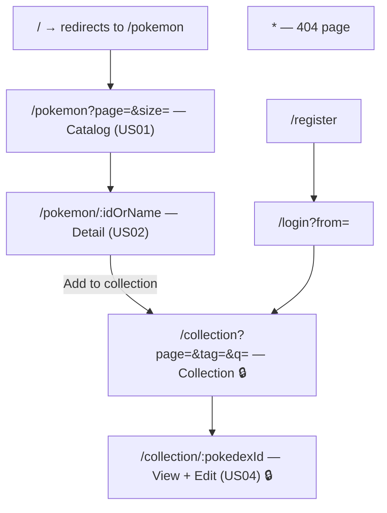
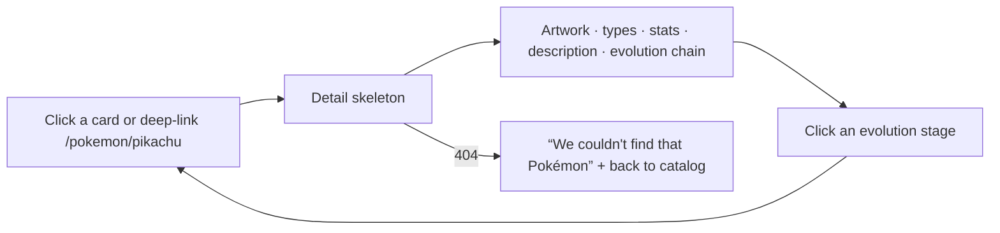
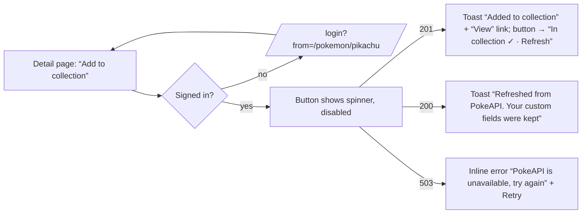
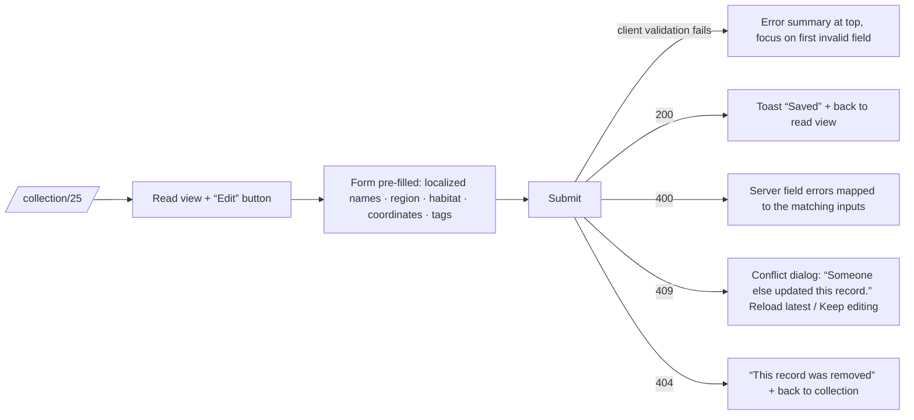

# UI / UX Design

> Related: [architecture.md §3](architecture.md) (Next.js rendering and state) · [ADR 0009](adr/0009-heroui-v3-component-library.md) (HeroUI v3) · [ADR 0010](adr/0010-nextjs-app-router.md) (Next.js) · [security.md §5](security.md) · [testing-strategy.md](testing-strategy.md)

**Stack:** Next.js 16 App Router · React 19 · **HeroUI v3** (built on React Aria) · Tailwind CSS v4 · Redux Toolkit for collection and auth state.

The exercise grades the frontend on **responsiveness**, **user-centric design**, **CRUD for the user stories**, **clean component structure and efficient state management**, and **no console warnings**. This document sets out how the UI will meet each of these before any component is built.

## 1. Design principles

| # | Principle | In practice |
|---|---|---|
| P1 | **Mobile-first, responsive** | Layout designed at 375 px first, then enhanced at 768 / 1024 / 1280 px |
| P2 | **Always show the system state** | Every async view has loading, empty, error and success states; every action gives feedback |
| P3 | **Accessible by default** | WCAG 2.2 AA; keyboard-only use is fully supported |
| P4 | **The URL is the state** | Page number, filters and the selected Pokémon live in the URL, so they can be shared and back/forward works |
| P5 | **Forgiving forms** | Inline validation, clear messages, nothing lost on error, concurrent-edit conflicts explained |
| P6 | **Fast where it counts** | Skeletons instead of spinners, image lazy-loading, next page prefetched |
| P7 | **Consistent** | One design-token set, one component library, one place for microcopy |

## 2. Users

| User | Goal | Main screens |
|---|---|---|
| **Visitor** (anonymous) | Browse Pokémon and read the details | Catalog, Detail |
| **Trainer** (`USER`) | Build and curate the team's collection with our own data | Detail → "Add to collection", Collection, Edit |
| **Admin** (`ADMIN`) | Same as Trainer, plus remove records | Collection (delete) |

## 3. Information architecture

### 3.1 Sitemap and routes



**Routes → files (Next.js App Router):**

| Route | File | Type | Built-in states |
|---|---|---|---|
| `/` | `app/page.tsx` | Server: `redirect('/pokemon')` | — |
| `/pokemon` | `app/(public)/pokemon/page.tsx` | Server Component | `loading.tsx` (skeleton grid), `error.tsx` |
| `/pokemon/[idOrName]` | `app/(public)/pokemon/[idOrName]/page.tsx` | Server Component + client `AddToCollectionButton` | `loading.tsx`, `not-found.tsx`, `error.tsx` |
| `/login`, `/register` | `app/(auth)/…/page.tsx` | Client Component | — |
| `/collection` | `app/(protected)/collection/page.tsx` | Client Component (RTK Query) | Skeleton via RTK `isLoading` |
| `/collection/[pokedexId]` | `app/(protected)/collection/[pokedexId]/page.tsx` | Client Component | Same |
| anything else | `app/not-found.tsx` | Server | — |

### 3.2 App shell

```
┌──────────────────────────────────────────────────────────────┐
│ [Skip to content]                                            │
│ ◓ Pokédex      Catalog   Collection🔒        [Log in] / [👤 ▾] │
├──────────────────────────────────────────────────────────────┤
│ <main id="content"> … page … </main>                         │
├──────────────────────────────────────────────────────────────┤
│ Data from PokeAPI · v1.0                                     │
└──────────────────────────────────────────────────────────────┘
Mobile (< 768 px): nav collapses into a ☰ button that opens a HeroUI Drawer
```

- Header links: **Catalog** always; **Collection** only when signed in.
- User menu (signed in): display name, role badge, **Log out**.
- Each route sets its title with `generateMetadata` (`Pikachu · Pokédex`). Next.js's built-in route announcer tells screen readers about the page change, and focus moves to the page `<h1>`.

## 4. User flows

### US01: Browse the catalog
```mermaid
flowchart LR
    A[Open /pokemon] --> B{Data in cache?}
    B -- yes --> D[Show grid instantly]
    B -- no --> C[Skeleton grid] --> D
    D --> E[Next / Prev / page number]
    E --> F[URL ?page= updated] --> B
    D -.prefetch.-> G[Next page loaded in the background]
    C -- error --> H[Error state + Retry]
    D --> S["Find a Pokémon: type 1+ characters"] --> T[Suggestions as you type, debounced 200 ms] --> U[Pick one or press Enter on an exact name/number] --> V[Open /pokemon/{id}]
```

### US02: Detail view


### US03: Add to collection (sync)


### US04: Edit custom attributes


## 5. Wireframes

### 5.1 Catalog (US01)

```
Desktop ≥ 1280 px — 5 columns                          Mobile 375 px — 2 columns
┌──────────────────────────────────────────────────┐   ┌───────────────────────┐
│ Pokémon                                          │   │ Pokémon               │
│ Find a Pokémon [ name or number… ▾ ]             │   │ [ Find a Pokémon… ]   │
│            Showing 1–20 of 1,351  ‹ Prev 1/68 Next›│   │ 1–20/1,351 ‹ 1/68 ›   │
├─────────┬─────────┬─────────┬─────────┬──────────┤   ├──────────┬────────────┤
│ [SPRITE]│ [SPRITE]│ [SPRITE]│ [SPRITE]│ [SPRITE] │   │ [SPRITE] │ [SPRITE]   │
│ #001    │ #002    │ #003    │ #004    │ #005     │   │ #001     │ #002       │
│Bulbasaur│Ivysaur  │Venusaur │Charmand.│Charmeleon│   │Bulbasaur │Ivysaur     │
│[Grass][Poison]    │ …       │ [Fire]  │ [Fire]   │   │[Grass][Poison]        │
│Seed Pkm │Seed Pkm │Seed Pkm │Lizard   │Flame     │   │Seed Pkm  │Seed Pkm    │
│Weight   │         │         │         │          │   │Weight    │            │
│ 6.9 kg  │ 13.0 kg │ 100.0 kg│ 8.5 kg  │ 19.0 kg  │   │ 6.9 kg   │ 13.0 kg    │
│Abilities│         │         │         │          │   │Abilities │            │
│Overgrow │Overgrow │Overgrow │Blaze    │Blaze     │   │Overgrow  │Overgrow    │
│Chloro.* │Chloro.* │Chloro.* │Solar P.*│Solar P.* │   │Chloro.*  │Chloro.*    │
├─────────┴─────────┴─────────┴─────────┴──────────┤   ├──────────┴────────────┤
│   ‹ Prev   1  2  3 … 68   Next ›   [20 ▾]/page    │   │  ‹ Prev  2/68  Next › │
└──────────────────────────────────────────────────┘   └───────────────────────┘
* = hidden ability (italics + a visible “(hidden)” label)
```

**Card content (US01):** sprite (the 96 px PokeAPI sprite scaled 1.5–1.7× with `image-rendering: pixelated`, directly on the card, no grey well), Pokédex number, name, **type chips** (`TypeBadge`, `bg-type-*`), **category**, **weight (kg)** and **abilities (skills)**, each with a small label. The whole card is one link (`<a>` wrapping an `<article>`), with hover (slight sprite zoom, off with reduced motion) and focus states.

**Find a Pokémon (autocomplete):** a HeroUI ComboBox above the grid. After the first character it calls `GET /api/v1/pokemon/search` (debounced 200 ms) and shows up to 10 suggestions as `#025 Pikachu`; picking one (mouse or arrow keys + Enter), or pressing Enter on an exact name or number, opens `/pokemon/{id}`. States: “Searching…”, “No Pokémon match”, and an inline “Search is unavailable right now” on 503. Input outside `[a-z0-9-]{1,50}` (after normalization) sends no request.

**Pagination** appears twice: a compact `‹ Prev · n / N · Next ›` next to “Showing …” at the top, and the full pager with page size at the bottom. Page and size live in the URL.

### 5.2 Detail (US02)

```
Desktop ≥ 1024 px — two columns, no panel stretched to its neighbour's height
┌──────────────────────────────────────────────────────────────────────┐
│ Catalog › Venusaur                                                   │
│ ┌───────────────────────────┐  #003                                  │
│ │                           │  Venusaur                              │
│ │   official artwork        │  [Grass] [Poison]                      │
│ │   (max ~384 px tall)      │  Height 2.0 m   Weight 100.0 kg        │
│ └───────────────────────────┘  Abilities: Overgrow · Chlorophyll*    │
│ ┌───────────────────────────┐  [ ＋ Add to collection ]               │
│ │ Base stats      Total 525 │  About                                 │
│ │ HP       80 ████████░░░░  │  “A bewitching aroma wafts from …”     │
│ │ Attack   82 ████████░░░░  │  Evolution                             │
│ │ …                         │  ┌───────┐ Lv 16 ┌───────┐ Lv 32 ┌─This Pokémon─┐│
│ └───────────────────────────┘  │[art]  │  →    │[art]  │  →    │ [art]        ││
│                                │#001   │       │#002   │       │ #003         ││
│                                │Bulba. │       │Ivysaur│       │ Venusaur     ││
│                                └───────┘       └───────┘       └──────────────┘│
└──────────────────────────────────────────────────────────────────────┘
Mobile (one column): artwork, info, About, Evolution, Base stats.
Branching chains (Eevee): the first stage, then the branches wrapping 4 per row (2 on narrow screens), triggers aligned.
```

- **Evolution sits in the right column, directly under About**, so at 1206 × 858 it is visible without scrolling (the human rejected a separate full-width Evolution row: “it's taking so much space”).
- **Stage cards:** all the same compact size (112 px wide), with the **official artwork** in an 80 px box (built from the species id on the allow-listed path; the sprite is the fallback), number and name. Each card is a link with hover (slight lift, accent border) and a clear focus ring.
- **Current stage:** an accent border **plus** a small “This Pokémon” badge on the card's top edge (never colour alone; no extra height) and `aria-current="page"`.
- The arrow between stages is a text character (an inline SVG triggered a CSP inline-style violation), with the trigger in words below it (“Level 16”, “Use Thunder Stone”, “Trade”).
- Labels: **Weight** (not “Mass”), matching the catalog cards.

### 5.3 Collection (protected)

```
Desktop: table                                              Mobile: card list
┌──────────────────────────────────────────────────────┐   ┌──────────────────────┐
│ My collection  [🔍 search name ] [tag ▾]  12 records │   │ [🔍 ] [tag ▾]        │
├────┬──────────┬──────────┬────────────┬──────┬───────┤   ├──────────────────────┤
│ #  │ Name     │ Local    │ Region     │ Tags │       │   │ #025 Pikachu         │
├────┼──────────┼──────────┼────────────┼──────┼───────┤   │ ピカチュウ · Kanto    │
│025 │ Pikachu  │ ピカチュウ│ Kanto      │ starter│ ⋯  │   │ [starter] [electric] │
│001 │ Bulbasaur│ Bisasam  │ Kanto      │ grass │ ⋯   │   │ Synced 2 h ago   ⋯   │
└────┴──────────┴──────────┴────────────┴──────┴───────┘   └──────────────────────┘
Row menu ⋯ : View · Edit · Refresh from PokeAPI · Delete (ADMIN only)
```

Empty state: *"Your collection is empty. Browse the catalog and add your first Pokémon."* plus a **Browse catalog** button.

### 5.4 Edit custom attributes (US04)

```
┌──────────────────────────────────────────────────────────────┐
│ Edit Pikachu                                     v3 · synced │
│ ┌ There are 2 problems with this form ───────────────────┐   │
│ │ • Latitude must be between -90 and 90                  │   │
│ │ • Tag "Fire Type!" may only contain a–z, 0–9 and -     │   │
│ └────────────────────────────────────────────────────────┘   │
│ Localized names                                              │
│  [ja ▾] [ピカチュウ        ] 🗑                                │
│  [de ▾] [Pikachu           ] 🗑      [+ Add language]        │
│ Region   [Kanto            ]   Habitat [Viridian Forest   ]  │
│ Latitude [91      ] ⚠ Must be between -90 and 90             │
│ Longitude[139.69  ]                                          │
│ Tags     [starter ×] [electric ×] [type a tag…  ]   2/10     │
│                                                              │
│ Read-only (from PokeAPI): name, sprite, stats, abilities     │
│                                    [Cancel]  [Save changes]  │
└──────────────────────────────────────────────────────────────┘
```

- Upstream fields are shown read-only, with a note explaining that they come from PokeAPI. This makes rule BR-06 visible to the user instead of a surprise 400.
- `version` is sent in a hidden field. On a 409 conflict the dialog offers **Reload latest** or **Keep editing**.

### 5.5 Log in / Register

Single-column centred card, max width 400 px. Password field with a show/hide toggle. On Register: the rules (12–64 characters) are shown up front, and a strength hint explains why a password was rejected (common password). Login errors are generic: *"Email or password is incorrect."* On 429: *"Too many attempts. Try again in 42 s."*

## 6. Design system: HeroUI v3

The component library is **HeroUI v3** ([ADR 0009](adr/0009-heroui-v3-component-library.md)), built on **React Aria Components**, so keyboard support, focus handling and ARIA patterns come built in. Everything was checked against the [HeroUI docs](https://heroui.com/docs/react/getting-started) on 2026-10-19.

### 6.1 Setup

| Item | Choice |
|---|---|
| Packages | `@heroui/react`, `@heroui/styles` (peer deps: React 19+, Tailwind CSS v4) |
| CSS entry (`app/globals.css`) | `@layer theme, base, components, utilities;` → `@import "tailwindcss";` → `@import "@heroui/styles";` → `@import "../styles/themes/pokedex.css" layer(base);` (HeroUI defines its variables in `base`; a `theme`-layer override would lose to them) |
| Provider | **None needed** for components. `<Toast.Provider placement="bottom end" />` mounted once in the root layout |
| Theme / dark mode | `next-themes` `ThemeProvider attribute="class" defaultTheme="system"` + `suppressHydrationWarning` on `<html>`. Its inline script gets the CSP nonce. Toggle in the user menu (Light / Dark / System) |
| Router links | `AppLink` = HeroUI `Link`/`Button` with `render={({ref, ...props}) => <NextLink {...props} ref={ref} href=… />}` |
| Events | React Aria names: `onPress`, `isDisabled`, `isInvalid`, `isRequired` (not `onClick` / `disabled`) |
| Composition | Compound parts, e.g. `<Card>` + its sub-components, `<Alert>` + `<Alert.Title>` (the docs' recommended style) |
| AI assistance | HeroUI MCP server (`@heroui/react-mcp`) so the AI works from v3 docs |

### 6.2 Design tokens (HeroUI CSS variables)

HeroUI's theme uses CSS variables mapped to Tailwind with `@theme inline`. A plain variable is a background color; its `-foreground` partner is the text color used on it. `styles/themes/pokedex.css` overrides them for light and dark:

| Group | Variables | Our values / use |
|---|---|---|
| Base | `--background`, `--foreground` | Neutral page background and text |
| Containers | `--surface` (cards, tables), `--overlay` (modals, popovers, toasts) + `-foreground` | Card and dialog backgrounds |
| Brand | `--accent` / `--accent-foreground` | **Pokédex red** (e.g. `oklch(0.58 0.22 27)`), lighter in dark mode |
| Status | `--success`, `--warning`, `--danger` (+ `-foreground`) | Toasts, alerts, form errors |
| Other | `--default`, `--muted`, `--border`, `--separator`, `--focus`, `--link` | Muted text, borders, **visible focus ring** |
| Fields | `--field-background`, `--field-foreground`, `--field-*` | Inputs |
| Shape | `--radius: 0.75rem` (others derive from it) | Cards, fields |
| **Custom: Pokémon types** | `--type-fire`, `--type-water`, … (18) + `-foreground`, bridged with `@theme inline { --color-type-fire: var(--type-fire); … }` | `bg-type-fire text-type-fire-foreground` on type chips; every pair checked for **≥ 4.5:1** in both themes |

- **Typography:** system font stack (no web-font request, nothing to allow in CSP); HeroUI `Typography` for headings.
- **Spacing:** Tailwind's 4 px scale. **Motion:** HeroUI defaults; `prefers-reduced-motion` respected.
- **Breakpoints:** Tailwind's `sm 640` · `md 768` · `lg 1024` · `xl 1280`.
- **Rule:** no hardcoded colors in components; only semantic utilities (`bg-surface`, `text-muted`, `bg-type-*`).

### 6.3 Responsive grid

| Width | Catalog columns | Collection | Detail |
|---|---|---|---|
| < 640 | 2 | cards | stacked |
| 640–1023 | 3 | cards | stacked |
| 1024–1279 | 4 | table | 2 columns (art · info) |
| ≥ 1280 | 5 | table | 2 columns, max width 1200 px |

### 6.4 Our components → HeroUI components

| Our component | Built with (HeroUI v3) | Notes |
|---|---|---|
| `AppShell` header | **Custom** (HeroUI v3 has no Navbar): `Link`, `Button`, `Separator`, **`Drawer`** (mobile menu) | Landmarks `header`/`nav`/`main`/`footer`, skip link |
| `UserMenu` | **`Dropdown`** + **`Avatar`** + **`Chip`** (role) | Theme switch, Log out |
| `PokemonCard` | **`Card`** + `next/image` + **`Chip`** | The whole card is a single `AppLink`; image `width`/`height` set |
| `TypeBadge` | **`Chip`** with `bg-type-*` classes | Text label, never color alone |
| `CatalogPagination` | **`Pagination`** + **`Select`** (page size) | Page links update `?page=`; `aria-current` |
| `StatMeters` | **`Meter`** | Native meter semantics (value 0–255) with a visible label and value |
| `EvolutionTree` | **Custom** `ul`/`li` + **`Card`** + `AppLink`; **`ScrollShadow`** on narrow screens | Branches shown as a wrapping grid |
| `Skeleton` states | **`Skeleton`** (in `loading.tsx` and RTK `isLoading`) | Matches the final layout |
| Spinners | **`Spinner`** inside `Button` while a request runs | Button `isDisabled` while pending |
| `ErrorState` | **`Alert`** (danger) + `Button` "Retry" | Shows `correlationId` |
| `EmptyState` | **Custom** on **`Surface`** + `Button` | Illustration + action |
| Toasts | **`Toast.Provider`** + `toast.success()` / `toast.danger()` | Labelled landmark region, `F6` / `Alt+T` to reach it, announced automatically, pauses on hover/focus |
| Forms | **`Form`**, **`TextField`** + **`Label`** + **`Description`** + **`FieldError`**, **`NumberField`** (lat −90..90, lon −180..180), **`ComboBox`** (language tag), **`TagGroup`** + `Input` (tags), **`InputGroup`** (password show/hide) | React Hook Form `Controller` + Zod; server `errors[]` mapped onto fields |
| `ErrorSummary` | **`Alert`** (danger) with links to fields | Receives focus on a failed submit |
| Confirm delete / 409 conflict | **`AlertDialog`** | Focus trap, Esc closes, names the record |
| Collection list | **`Table`** (≥ 1024 px) / **`Card`** list (< 1024 px), **`SearchField`**, **`Select`** (tag filter), **`Dropdown`** (row actions) | Sortable by number / name |
| Detail back link | **`Breadcrumbs`** | `Catalog › Pikachu` |
| Hidden-ability hint | **`Tooltip`** | Also has a visually hidden text label |

## 7. State and feedback matrix

| Screen | Loading | Empty | Error | Unauthorized |
|---|---|---|---|---|
| Catalog | Skeleton grid (20 cards) | "No Pokémon on this page" + go to page 1 | `ErrorState` + Retry (503: "PokeAPI is unavailable") | — |
| Detail | Skeleton layout | — | 404 page variant / `ErrorState` | — |
| Collection | Skeleton rows | `EmptyState` + Browse catalog | `ErrorState` + Retry | Redirect to login |
| Edit | Form skeleton | — | Field errors / `ErrorSummary` / 409 dialog / 404 notice | Redirect to login |
| Login / Register | Button spinner | — | Generic auth error / 429 countdown / field errors | — |

**Action feedback:** buttons switch to a spinner and are disabled while a request runs, so a double submit is impossible. Success → toast. Failure → inline error near the action. Destructive actions → confirmation dialog naming the record (*"Delete Pikachu from the collection?"*).

## 8. Content and microcopy

- **Tone:** friendly and short; no technical jargon in user-facing errors.
- **Names:** API slugs become display names (`mr-mime` → "Mr. Mime", `ho-oh` → "Ho-Oh") via a formatter with an exceptions map.
- **Units:** always shown (`6.9 kg`, `0.4 m`), one decimal place.
- **Numbers:** Pokédex numbers zero-padded to 3 digits (`#025`).
- **Error messages** come from a single map of `ProblemDetail.type` → copy, falling back to `detail`.
- **Language:** English UI. Strings are kept in one module so translation can be added later. The user's `localizedNames` show next to the English name.

## 9. Accessibility (WCAG 2.2 AA)

| Requirement | How |
|---|---|
| Contrast | Text ≥ 4.5:1, large text and UI elements ≥ 3:1; checked for every token pair, including type badges and dark mode |
| Keyboard | All controls reachable by Tab in a logical order; visible focus ring (`:focus-visible`, 2 px offset); no keyboard traps; Esc closes dialogs and menus |
| Target size | Interactive targets ≥ 24×24 px (WCAG 2.2 SC 2.5.8); ≥ 44×44 px for primary mobile actions |
| Structure | One `<h1>` per page, heading levels in order, landmarks, skip link |
| Images | Meaningful `alt` text ("Pikachu official artwork"); decorative icons `aria-hidden` |
| Forms | Real `<label>`s, errors linked and announced, `autocomplete` attributes on auth fields |
| Dynamic content | Next.js route announcer + `generateMetadata` titles; focus moves to `<h1>`; HeroUI toasts announced automatically |
| Motion | `prefers-reduced-motion` respected |
| Color | Never the only signal: types have labels, errors have icons + text |

## 10. Performance budgets

| Metric | Budget |
|---|---|
| LCP | < 2.5 s |
| CLS | < 0.1 (all images have dimensions; skeletons match the final layout) |
| INP | < 200 ms |
| Initial JS (gzip) | < 200 KB; Next.js code-splits per route automatically; catalog pages ship almost no JS (Server Components) |
| Images | `next/image` (sized, lazy by default, modern formats); detail artwork loaded with `priority`; `remotePatterns` limited to the PokeAPI sprites path |
| Data | Catalog rendered on the server, backed by the API's Caffeine cache; `next/link` prefetches the next page; RTK Query cache for the collection |

## 11. UX acceptance criteria (written as Playwright scenarios)

| Story | Given / When / Then |
|---|---|
| US01 | **Given** the catalog **when** I open `/pokemon` on a 375 px screen **then** I see 2 columns of cards, each showing sprite, name, category, mass and abilities, and pagination works with the keyboard |
| US01 | **Given** page 2 **when** I press browser Back **then** I return to page 1 at the same scroll position |
| US02 | **Given** `/pokemon/eevee` **then** the evolution section shows all 8 branches, and each stage is a link |
| US02 | **Given** `/pokemon/does-not-exist` **then** I see a friendly not-found page with a link back to the catalog |
| US03 | **Given** I'm signed out **when** I click "Add to collection" **then** I'm sent to login and, after signing in, returned to the same Pokémon |
| US03 | **Given** a Pokémon already in the collection **when** I sync again **then** my custom fields are unchanged and a toast says so |
| US04 | **Given** the edit form **when** I enter latitude 91 and submit **then** an error summary receives focus and the field shows the error |
| US04 | **Given** a stale version **when** I save **then** the conflict dialog appears and "Reload latest" shows the current data |
| Auth | **Given** I'm a `USER` **then** the Delete action isn't shown; **given** `ADMIN` **then** delete asks for confirmation and the record disappears |
| All | No console warnings or errors on any of the journeys above |

## 12. UX verification

| Check | Tool | Gate |
|---|---|---|
| Journeys at 375 / 768 / 1280 px | Playwright projects per viewport | All pass |
| Automated accessibility | `@axe-core/playwright` on every route | 0 serious / critical violations |
| Lighthouse | Lighthouse CI on catalog + detail | Accessibility ≥ 90, Performance ≥ 85, Best Practices ≥ 90 |
| Console hygiene | Playwright console guard | 0 warnings / errors |
| Manual | Keyboard-only pass + VoiceOver smoke test | Done before the presentation |
